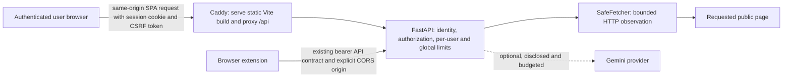

# SEO Sensei — Phase 1B focused design review

## Decision status

This is a comparison package, not production approval. Both candidates are isolated static prototypes. No production interface, API, authentication, scoring, deployment, or Streamlit code changed.

**Provisional preference: Evidence Ledger.** It makes the consequential observation easiest to read on the narrowest screen, while keeping the audit compact and the detail view source-led. Trace Studio remains a credible alternative if persistent workspace orientation matters more than the simpler reading path. The user must select or reject a direction before implementation begins.

## Baseline and product shape

- Base: accepted Phase 1A commit `8d43a83d40b3ecc26a5ef9406e7b160fe3743547`, on branch `design/phase-1b-focused-exploration`.
- Original audit: `0a5ff9dfb5ba70a3c706af5a6bb40714432fa0d3`.
- Product user: a site owner, editor, or small content team checking one page before making a change elsewhere.
- Core journey: enter a URL → observe one bounded fetch and parsed static HTML → inspect rule outcomes → read evidence and a possible fix → make the change outside SEO Sensei → fetch again and verify.

The accepted API contracts distinguish `SEOCheck.status`, `points`, `max_points`, `evidence.observed`, `evidence.value`, and `recommendation`; they do not provide a severity/business-priority field or arbitrary source-node locations. Fetch metadata includes status, content type, final URL, byte count, redirects, elapsed time, and `X-Robots-Tag`. See [request schemas](../backend/app/schemas/requests.py), [response schemas](../backend/app/schemas/responses.py), and [SEO result models](../backend/app/seo/models.py).

Both prototypes load the existing [23-check fixture](../design/seo-sensei/fixtures/audit.json) and [fictional HTML page](../design/seo-sensei/fixtures/northstar-solar.html) from the local server. The example URL was not fetched. Fixture transport values are mocked. The 92/100 value is shown only as a weighted heuristic, with an explicit statement that it is not a Google ranking score or index check. A `fail`, `warning`, `pass`, or `not applicable` label is a rule outcome, not business priority.

The only page excerpt is the `noindex` meta element on line 8 of that fictional HTML fixture. The live API does not return arbitrary source excerpts or node locations; other detail views say so. Explanations and fix/verification text are labelled as prototype editorial copy or suggested actions and are never applied.

## Product priorities and boundaries

| Capability | Data source and output type | Recommendation |
|---|---|---|
| Technical and indexability observations | One SafeFetcher HTTP response plus parsed static HTML; observed values and deterministic rule classifications | Core. Show the actual directive/header and fetch context; never claim current Google index state. Google documents that `noindex` is a crawl-time instruction, while Search Console URL Inspection reports indexed and live-test views separately. [Robots meta guidance](https://developers.google.com/search/docs/crawling-indexing/robots-meta-tag), [URL Inspection](https://support.google.com/webmasters/answer/9012289). |
| Metadata, headings, visible-text and link diagnostics | Static response HTML parsed by the deterministic analyzer; observed counts/values plus heuristic warnings | Core. Group and filter the 23 checks; explain applicability and avoid treating fixed thresholds as ranking rules. |
| Structured-data observations | JSON-LD parsing from static HTML; parser result is observed, rich-result eligibility is unavailable | Core but carefully scoped. A parseable block does not establish policy compliance or guarantee a Search appearance. [Google structured-data policies](https://developers.google.com/search/docs/appearance/structured-data/sd-policies). |
| Evidence, explanation and fix checklist | Analyzer `evidence.observed` and `recommendation`; any additional prose is authored or explicitly AI-generated | Core. Label what the fetch returned separately from interpretation and suggested work. A checklist can guide work, but the product does not edit a CMS or publish changes. |
| Search and status filtering | Existing check list and rule status | Core. Keep status text visible, searchable, and independent of any future priority system. Carbon’s table guidance groups search and filters with the data toolbar and supports progressive row detail; the prototypes borrow that information principle without using a stock table skin. [Carbon data-table guidance](https://www.carbondesignsystem.com/building-blocks/core/components/data-table/guidelines). |
| Re-fetch and before/after comparison | Two user-requested analyzer responses; currently no history or persistence | Valuable secondary work. A useful diff needs explicit snapshot semantics and a retention/privacy decision; do not imply background monitoring or saved history. |
| Report export | Existing result fields only; not implemented | Valuable secondary work after a stable report contract. Export must retain provenance and score caveats and must not invent third-party measurements. |
| Optional Gemini suggestions | AI-generated text from the server-side provider; may be absent or fail | Optional, opt-in, separately budgeted, and visibly labelled. It must not alter deterministic findings or scores. The prototype contacts no provider. |
| Article generation and SEO boost | Existing authenticated AI endpoints; generated text, dependent on provider availability | Consolidate as optional writing assistance only if users value it; otherwise remove after usage/product review. These flows are separate from evidence-based page auditing, and SEO boost must not imply observed ranking lift. They were not redesigned here. |

Do not add rank tracking, search traffic, keyword positions, backlink/authority measures, competitor scores, Core Web Vitals, Google index state, or rich-result guarantees without a real source and explicit user authorization. Current fetch/static-HTML data does not contain them. Search Console measurements would require an approved account connection and its own consent, quotas, and provenance.

Google notes that a crawled `noindex` instruction only helps when the crawler can access the page; a single fetch cannot reveal whether Google has processed it. URL Inspection distinguishes the indexed version from a live test and does not guarantee search appearance. Accordingly, both prototypes say the observation does not establish Google’s current index state and point to URL Inspection as a separate verification step.

## Candidate A — Evidence Ledger

**Thesis.** A professional inspection instrument: compact, carefully edited, and built around the returned observation rather than a dashboard frame. The editorial influence is retained in typographic hierarchy, not in newspaper columns, a long introduction, or edition labels.

- **Palette:** paper `#F4F2EC`, white sheet `#FFFEFA`, ink `#1C3032`, muted text `#4E6262`, rules `#C8CECA`, teal `#28645D`; fail `#9F3B30`, warning `#79500F`, pass `#286349`.
- **Type/licensing:** system Georgia/Iowan Old Style/Times for page and finding titles; Segoe UI/Arial for controls and body; Consolas for URLs and source text. No font is downloaded or redistributed; production font choice and licensing would be reviewed separately.
- **Layout/navigation:** a short masthead, compact URL form, two-view navigation, a centered 1120px reading canvas, and one full-width lead finding. A 4px base spacing scale uses mostly 8/12/20px gaps. Categories appear only after the key observation and fetch context. Finding rows pair the title/status with observed evidence. Detail separates observation, interpretation, possible next step, and verification guidance.
- **Data display:** aligned status counts and restrained text values; no bars, gauge, decorative score chip, or chart. The score is visually secondary and fully qualified.
- **Interaction/motion:** Overview ↔ All checks; live local search and status filter; select a row to open evidence; return preserves the filter/search. The 650ms recheck is an explicitly labelled simulation that sends no request and changes no result. Smooth scrolling is disabled under `prefers-reduced-motion`.
- **Responsive/accessibility:** single-column form, finding, and detail at narrow widths; visible skip link and focus ring; words identify statuses in addition to color. Its 320px view keeps the key observation ahead of category summaries.
- **Tradeoff:** strongest reading comfort and direct issue recognition; it gives up the persistent orientation and always-visible context of a workspace rail.

## Candidate B — Trace Studio

**Thesis.** A contextual investigation workspace: a deep-green rail holds the page identity and view navigation while a light inspection surface keeps the evidence readable. It is a composed light/dark instrument, not an all-dark developer console.

- **Palette:** rail `#173634`, raised rail `#204541`, rail text `#F4F6ED`, muted rail text `#C0D0C9`, active lime `#D5E67B`, light canvas `#F0F2EC`, sheet `#FFFEFA`, ink `#1E3031`, teal `#21655D`; fail `#A13D30`, warning `#77500F`, pass `#286349`.
- **Type/licensing:** Segoe UI/Arial for body and interface; Consolas for URLs/source; the operating system supplies these fonts. No external font assets. A production choice would be validated for licensing and deployment.
- **Layout/navigation:** fixed 224px rail and breadcrumb on desktop; finding first in a main/context split; a compact navigation strip replaces the rail on small screens. A 4px base scale keeps most control and row spacing at 8–16px. Detail retains navigation/page context alongside the evidence and suggested next step.
- **Data display:** the same status words and category counts; no chart or gauge. The score remains subordinate in the right context column. A separate note explicitly says that fail/warning does not rank business importance.
- **Interaction/motion:** rail and category links switch the local views; a finding opens an evidence inspector and returns to the same filtered list. A 140ms entrance transition marks the view change; `prefers-reduced-motion` removes it and smooth scrolling.
- **Responsive/accessibility:** the rail collapses to top navigation; detail and findings become one column; long evidence wraps. Skip link, semantic controls, labels, and focus states are present. The dark rail costs more vertical space on mobile than Candidate A.
- **Tradeoff:** strongest orientation and sense of moving between observation and action; the fixed rail, breadcrumb, and entry form consume more space and can make the interface feel more like a work console.

Selected palette pairs were contrast-calculated as a spot check, not as a complete WCAG audit. A: ink/paper 12.36:1, muted/paper 5.78:1, status text/background pairs at least 6.19:1, focus blue/paper 6.15:1. B: ink/canvas 12.23:1, rail text/rail 11.93:1, rail muted/rail 8.12:1, active lime/rail 9.56:1, and status text/background pairs at least 6.03:1. The Trace Studio focus indicator uses a dark outline plus lime outer ring so it remains distinct on both light content and the dark rail. These values cover selected CSS token pairs only.

## Phase 1A review changes

| Phase 1A weakness | Phase 1B response |
|---|---|
| Audit Press opened with a large introduction and left the audit too far down on mobile | Evidence Ledger compresses the entry/header and puts the actual `noindex` finding before score or categories. It drops field-note/edition decoration. |
| Signal Room felt like a generic developer dashboard; small mobile priority was buried | Trace Studio uses a light content surface, editorial title rhythm, text-only category summaries, and a finding-first split. The fixed navigation rail remains, but there are no monitoring charts or arbitrary KPI cards. |
| Field Notes overemphasized the score and made the workflow look permanently staged | Both designs demote and qualify the score, remove numbered stages, and make recheck an explicit one-off simulation. |

Both preserve Phase 1A’s useful source explanation and observation-to-fix sequence, while removing ornamental labels, score spectacle, filler metrics, and redundant cards.

## Screenshots and prototypes

Open the [comparison gallery](../design/seo-sensei/phase-1b/index.html), [Evidence Ledger](../design/seo-sensei/phase-1b/evidence-ledger/index.html), or [Trace Studio](../design/seo-sensei/phase-1b/trace-studio/index.html). These are static local prototypes; the gallery preview and all captures below use the same illustrative fixture.

To run them locally, start `python -m http.server 8765 --bind 127.0.0.1` from the repository root and open `http://127.0.0.1:8765/design/seo-sensei/phase-1b/index.html`. The prototypes load only the relative fixture files over that local server.

| Candidate | Desktop overview 1440×900 | Mobile overview 390×844 | Desktop findings 1440×900 | Mobile findings 390×844 | Desktop detail 1440×900 | Mobile detail 390×844 |
|---|---|---|---|---|---|---|
| Evidence Ledger | [PNG](../design/seo-sensei/phase-1b/screenshots/evidence-ledger-desktop-overview.png) | [PNG](../design/seo-sensei/phase-1b/screenshots/evidence-ledger-mobile-overview.png) | [PNG](../design/seo-sensei/phase-1b/screenshots/evidence-ledger-desktop-findings.png) | [PNG](../design/seo-sensei/phase-1b/screenshots/evidence-ledger-mobile-findings.png) | [PNG](../design/seo-sensei/phase-1b/screenshots/evidence-ledger-desktop-detail.png) | [PNG](../design/seo-sensei/phase-1b/screenshots/evidence-ledger-mobile-detail.png) |
| Trace Studio | [PNG](../design/seo-sensei/phase-1b/screenshots/trace-studio-desktop-overview.png) | [PNG](../design/seo-sensei/phase-1b/screenshots/trace-studio-mobile-overview.png) | [PNG](../design/seo-sensei/phase-1b/screenshots/trace-studio-desktop-findings.png) | [PNG](../design/seo-sensei/phase-1b/screenshots/trace-studio-mobile-findings.png) | [PNG](../design/seo-sensei/phase-1b/screenshots/trace-studio-desktop-detail.png) | [PNG](../design/seo-sensei/phase-1b/screenshots/trace-studio-mobile-detail.png) |

All twelve PNGs were captured from the running local prototypes in Edge Chromium using browser device metrics. CSS viewport and image dimensions were verified as 1440×900 or 390×844; each page loaded all 23 checks. No external page, production API, or AI provider was contacted.

## Side-by-side evaluation

| Criterion | Evidence Ledger | Trace Studio | Evidence from this review |
|---|---|---|---|
| Find the consequential observation | Immediate, broad editorial lead | Immediate lead in the content pane; context appears alongside | Both show the `noindex` result before categories. On 390×844, both show the core finding before secondary status/category information. |
| Scan/filter 23 checks | Wide title/evidence rhythm; category and source hints are quiet | Compact title/status plus evidence/source context | Both showed 23 rows, a 0-result search state, and an N/A-only result; the longest fixture evidence string (82 characters) wrapped without horizontal overflow at 390px. |
| Separate evidence, interpretation, action | Strong stacked reading blocks and explicit fixture line | Strong contextual split and persistent page frame | Both identify the robots line as fictional-fixture-only; for other rules they name analyzer evidence and disclose the missing source-node location. Fix text says “not applied”/“suggestions only.” |
| Narrow mobile | Less navigation chrome; cleaner issue-first sequence | Rail becomes top tabs but breadcrumb and URL form add height | At 390 and 320 CSS px, neither document required horizontal scrolling; both retain the issue before categories. A is the quieter mobile path. |
| Readability/accessibility risks | Smaller uppercase captions need content/contrast review; focus ring clear | More density and a dark/light focus boundary to manage | Body is 16px; essential statuses are textual. Keyboard skip link was visible in both; Enter moved to `#main-content`. Selected palette/focus pairs were contrast-calculated. No screen-reader or full WCAG audit was performed. |
| Originality/coherence | Restrained warm surface and serif/sans rhythm; edited instrument rather than newspaper | Deep rail/light work surface; contextual investigation rather than generic dark tooling | Screenshot inspection shows substantially different page structure, not a palette swap. Preference was not tested with users. |

The provisional preference is **Evidence Ledger** for the current primary task: reading a single result carefully and deciding what to change. Trace Studio is preferable if the future product expands into many-page, repeated investigations where persistent context proves valuable. Neither should be selected based on these screenshots alone; a short usability review with representative site owners/editors should decide.

## Architecture and trust boundary

Phase 0 confirms FastAPI has authenticated work routes, a deterministic analyzer and SafeFetcher; Streamlit currently holds the dashboard bearer credential server-side. The browser extension uses the existing API contract separately. No architecture in this section was implemented.

| Option | Fit to this repository | Tradeoffs |
|---|---|---|
| **A. React + TypeScript + Vite + FastAPI — preliminary recommendation** | Vite can ship static files; Caddy can serve those files and route same-origin `/api` to the already-server-side FastAPI app. FastAPI can own a user session; the browser never receives the current dashboard/operator bearer token. The existing extension remains on its separate bearer contract. | Lowest deployment/runtime complexity of the two SPA options; no current SSR requirement. Requires new, approved identity/session behavior in FastAPI and a reviewed Caddy packaging/routing change. Vite's local proxy can preserve same-origin development. |
| **B. Next.js + TypeScript + FastAPI** | A Next server can mediate requests and render server-side if a real requirement emerges. It does not eliminate the need for identity, session, authorization, CSRF, budgets, or persistence. | Adds a Node runtime and another server/proxy boundary beside FastAPI; duplicated auth and rate-limit policy are risks. No SSR or server-component requirement has been established. Not justified solely to keep one credential server-side because FastAPI can do that. |
| **C. Retain Streamlit temporarily** | Reuses the present dashboard and server-side API client while APIs and auth decisions stabilize. | Fastest short-term operational path, but not the refined product experience. The dashboard source has no login; Phase 0 records a verified high-severity exposure risk if its public Caddy route is reachable. Keep private/access-controlled only until that is addressed. |

**Trust requirements before a browser migration:** use a real user or approved external identity gate, then a server-side session (`Secure`, `HttpOnly`, deliberate `SameSite`), CSRF token and Origin checks for state-changing work, authorization on every endpoint, and per-user plus global crawler/AI budgets. CORS is not authentication. Do not put `API_ACCESS_TOKEN` or `DASHBOARD_API_ACCESS_TOKEN` in Vite variables, JavaScript, browser storage, or a shared anonymous gateway. A gateway forwarding one operator token to anonymous visitors is not acceptable. For a private demo, restrict the audience at a real access-control boundary; do not call that multi-user authentication. Public access additionally needs approved account/identity, session revocation, durable shared rate limits, persistence/retention rules, abuse controls, monitoring, and an operating budget.

Keep the extension's bearer authentication and exact API compatibility in view; extension-origin CORS and user-configured credentials remain a separate client boundary. Cookie-authenticated SPA requests must not silently change extension behavior. Decisions still needed: target private audience vs public users; identity/session owner; session persistence and CSRF policy; whether API contracts may add provenance/priority fields; reanalysis retention; export format; AI consent/cost; article/boost disposition; and final design/font licensing.

Phase 0 risks that constrain planning include [SEC-01: unauthenticated Streamlit dashboard exposure if the deployment is public](baseline-audit.md#8-ranked-defect-and-risk-register), a per-process rather than shared rate limiter, [SEC-02: app-level body enforcement depends on declared `Content-Length`](baseline-audit.md#8-ranked-defect-and-risk-register), and [SEO-01: score denominator/alt-text semantics can affect score interpretation](baseline-audit.md#8-ranked-defect-and-risk-register). This exploration does not repair or re-test them.

## Verification and limitations

- JavaScript: `node --check design/seo-sensei/phase-1b/shared/app.js` — PASS. Python `HTMLParser` parsed the gallery and both prototype documents; all local asset links resolved. A lexical CSS scan found balanced rules/comments/strings in all three stylesheets; Edge loaded the rendered stylesheets without errors.
- Browser interaction: both candidates loaded the local 23-check fixture; view navigation, 0-match search, N/A filtering, 50-character check title search, 82-character evidence display, detail open/return with filter preservation, empty and `file:`/loopback URL messages, AI-unavailable copy, and the disabled-then-complete 650ms recheck simulation were exercised in the in-app browser. The URL form only opens the bundled sample and never fetches an entered address.
- Keyboard: the skip link received `:focus-visible` on Tab and Enter reached `#main-content` in both candidates. Trace Studio's final focus ring is a 3px dark outline with a 6px lime outer ring; Edge computed both colors in the focused state. Browser inspection showed no console errors on the gallery, and both preview images loaded at 1440×900.
- Responsive: screenshots at 390×844; extra browser checks at 320×844 showed no horizontal overflow. A 200% effective desktop zoom was emulated as a 720×450 CSS viewport at device scale 2 (1440×900 capture); both documents remained within the 720 CSS-pixel width. This is a browser-metrics emulation, not a test of the browser's zoom menu or every text-only resizing mode.
- Motion/accessibility: with `prefers-reduced-motion: reduce` emulated in Edge, both pages reported the preference and switched smooth scrolling to `auto`; Trace Studio's view animation computed to `none`. No screen-reader session, assistive-technology test, full color-state audit, or WCAG conformance assessment was performed.
- Product isolation: only local fixture files are fetched by [shared/app.js](../design/seo-sensei/phase-1b/shared/app.js). It has no API route, credential, live crawl, or Gemini call.

Carbon's search/filter placement informed the finding toolbar. GOV.UK recommends small-screen-first layouts and keeping ordinary reading lines to roughly 75 characters; W3C's Reflow criterion describes 320 CSS-pixel single-direction reading, and Resize Text calls for text enlargement to 200% without loss. These are design references, not a compliance claim: [Carbon](https://www.carbondesignsystem.com/building-blocks/core/components/data-table/guidelines), [GOV.UK layout](https://design-system.service.gov.uk/styles/layout/), [WCAG Reflow](https://www.w3.org/WAI/WCAG21/Understanding/reflow), [WCAG Resize Text](https://www.w3.org/WAI/WCAG21/Understanding/resize-text).

**Approval gate:** choose Evidence Ledger, choose Trace Studio, request a narrowly scoped correction, or reject both. Neither is approved for production until the user explicitly selects a direction and the unresolved authentication/product decisions are reviewed. No Phase 1 implementation is authorized by this exploration.
