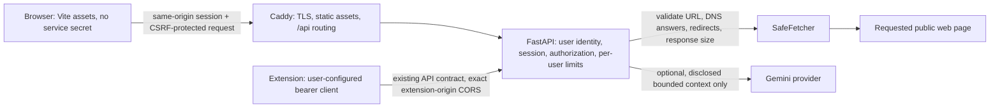

# SEO Sensei — Phase 1A Product and Design Decision

**Status:** Exploration package for review. The architecture and visual direction are not approved for implementation.

**Base:** `audit/phase-0-baseline` at `0a5ff9dfb5ba70a3c706af5a6bb40714432fa0d3`; original `main` baseline `eefd2393cb3447d15e4068159b5c1bdd6dd1605c`.

## Product direction

**Primary user:** a site owner, editor, or small content team reviewing one page before or after a publishing change. A developer or SEO consultant is a secondary user who needs to inspect the same technical observations.

**Core workflow:** submit a page URL → see bounded HTTP and static-HTML observations → review the most consequential checks first → open evidence, explanation, and a conditional fix → make the change in the site’s CMS → fetch and review the deployed page again. The tool reports what its fetch and rules observed; it does not certify search outcomes.

The current fetcher processes a bounded HTTP response and the analyzer parses its HTML; it is not a browser rendering engine. The API returns a versioned heuristic score and typed check summaries. A check has `pass`, `warning`, `fail`, or `not_applicable` status, but no separate severity, business priority, or source DOM location. Its evidence field is explanatory text, not a source selector or captured HTML excerpt. See the [analysis request/response contract](../backend/app/schemas/requests.py) and [SEO result models](../backend/app/seo/models.py#L15), plus the [Phase 0 API inventory](baseline-audit.md#2-architecture-and-repository-inventory).

The implemented product surface is narrower than a general SEO suite ([verified feature and test inventory](baseline-audit.md#3-implemented-feature-inventory)):

| Existing capability | Entry, inputs and outputs | Auth, tests and unavailable behavior |
|---|---|---|
| Deterministic URL review | `POST /analyse-url`: HTTP(S) URL and optional `include_ai_recommendations`; returns fetch metadata, extracted HTML summaries, checks and a versioned score. | Bearer auth and analysis limit. Covered by API, fetcher and engine tests. Invalid URLs return validation/policy errors; blocked or unavailable fetches do not produce an analysis. Deterministic output works without AI. |
| Gemini recommendations | Optional part of analysis, requested separately from the deterministic report; returns typed recommendations or an explicit state. | Additional AI limit, server key, provider quota/network. Mocked failure tests exist; no live Gemini call was made. Configuration/timeouts/invalid responses leave deterministic findings available. |
| Article drafting | `POST /generate-article`: topic, up to 20 keywords, and fixed tone; returns title, article text and suggestions. | Bearer auth, article limit and Gemini. Provider behavior is fake-tested; no-key API behavior is 503. Not persisted or published. |
| Description suggestion (“SEO boost”) | `POST /boost-seo`: URL; re-fetches/analyzes and returns one suggested description. | Bearer auth, boost limit, SafeFetcher and Gemini. No-key behavior is 503; provider failures are sanitized. It does not measure improvement. |
| Health/readiness | `/`, `/health`, and `/ready` return service/readiness status. | Public and lightweight. Tests exist. Readiness checks SafeFetcher initialization, not Gemini/provider or Google state. |
| Streamlit dashboard | `backend/dashboard.py` sends analysis/article/boost requests through `DashboardAPIClient`, stores report state in the Streamlit session and displays typed results. | Server-side dashboard token; no UI sign-in in current source. API client tests and a local health-button browser flow were verified in Phase 0; current dashboard route is not access-controlled by its own UI. |
| Manifest V3 extension | Popup submits active tab URL to analysis; options page configures API origin/token. It does not read page DOM. | `activeTab`, `storage`, optional HTTP(S) host access; operator bearer token is stored in local extension storage. Static syntax/manifest tests exist, but Chrome installation and extension-origin CORS were not runtime-tested. |

Not implemented: competitor discovery, keyword volume, backlink data, rank tracking, Search Console, PageSpeed/Core Web Vitals, current Google indexing state, whole-site crawling, report storage, exports, or before/after history. Do not present planned integrations as current capabilities.

### Prioritized product proposals

| Proposal | Benefit | Dependencies | Rough complexity | Validation | Cost and security concerns |
|---|---|---|---|---|---|
| Evidence-first overview, searchable checks and detail/fix/recheck flow | Helps users choose a justified next action without mistaking the score for an outcome. | Stable check IDs/status/category contract; decide what source provenance the API can safely return. | Medium | Task-based review with owners/editors and technical reviewers; test whether they can locate observation, limitation, and next step. | No provider cost. Returning excerpts increases privacy/content exposure; use bounded, escaped provenance and avoid full-page content. |
| Domain-review heuristic v2 and explicit N/A handling | Reduces false penalties and score inflation and makes status language more trustworthy. | SEO/domain review, version policy, counterexample fixtures, consumers of score v1. | Medium | Table-driven boundary cases and reviewed examples; compare v1/v2 without claiming correlation with rankings. | No provider cost; score changes affect integrations and user comparisons. Version and disclose migration. |
| Real access control before public exposure | Protects crawler/provider budget and separates user access. | Approved identity/session provider, FastAPI authorization, CSRF/Origin design, session/revocation storage and per-user/global limits. | Large | Reject anonymous work; verify users cannot cross-read data or consume another user’s quota; test revocation and abuse limits. | Identity, hosting and AI use may cost money. Session secrets, CSRF, recovery, privacy, and abuse response are security-critical. |
| Browser-only report export | Supports sharing a review without adding a report database. | Stable report schema; decide export fields, consent, masking, and format. | Small–medium | Compare exported/printed report with the result view and verify caveats and provenance remain present. | No provider cost; download can contain URLs and page metadata. Avoid hidden persistence or automatic sharing. |
| Before/after history | Makes a deployed change easier to review over time. | Explicit snapshot storage, ownership, retention/deletion, comparable score/version, and per-user authorization. | Medium–large | Re-run a fixed fixture and reviewed pages; verify result version and changed findings are accurate. | Storage/backup cost and sensitive URL/report retention; no persistence exists today. |
| Search Console or PageSpeed data | Adds signals the crawler cannot observe. | Separate integration decision, OAuth/API terms, property ownership, provider quotas, and provenance UI. | Large | Validate permission scopes, partial/unavailable responses, and metric timestamps against the source service. | OAuth tokens and search/performance data are sensitive; provider quotas and retention costs apply. |
| Gemini recommendations; article draft; boost disposition | Keeps useful generation optional and protects the evidence-led workflow. | Explicit consent/field disclosure, provider budget, human review, article/boost decision, external client inventory for boost. | Medium | Mock provider boundaries and failures; review output, preserve no-AI fallback, and verify consumers before removing boost. | Gemini usage is quota/budget-bound and sends selected page-derived context to the provider; generated claims are not measured facts. |

The prototypes use one bundled, fictional `northstar.example` HTML fixture and mock transport metadata. The address was never fetched. Its local deterministic result is 92/100 while containing a `noindex` directive; the overview therefore gives that observation prominence and labels the number a heuristic, not a Google ranking score. The prototype-only source excerpt is composed from the fixture; the production API does not currently return that excerpt or its source location. Do not promise node-level evidence in production without an approved, versioned contract change.

### Evidence and product boundaries

| Candidate | Recommendation | Data and product boundary |
|---|---|---|
| Technical/indexability observations | Essential | Observed response status, content type, redirect count, final URL, robots directives and static HTML fields. A fetched directive is not Google’s current index state. |
| Metadata, headings, links and images | Essential | Parsed title/description, heading text, anchor and image-alt counts. They are observations plus heuristic classifications; link targets and alt-text usefulness are not evaluated. |
| Structured data | Essential, explicitly narrow | Report JSON-LD blocks that parse or fail parsing. Parsing is not Schema.org validation, rich-result eligibility, display, or ranking. |
| Searchable, filterable findings and evidence/fix details | Essential | Group API checks by existing category/status. Status ordering is a review aid, not a severity field. Show observed text and its source class; explain limits and conditional next steps. |
| Recheck after a human change | Essential workflow | Repeat the existing URL analysis and compare the new observation manually. The current service has no report persistence or before/after history. |
| Export | Secondary, after contract stabilizes | Could produce a user-triggered summary/print view from a report already in the browser. Define privacy, retention, and export contents first; no export exists today. |
| Before/after comparison | Defer | Needs deliberate snapshot persistence, ownership, retention, and a comparable versioned score/check contract; do not imply that history exists. |
| Optional Gemini recommendations | Secondary and opt-in | AI-generated suggestions based on bounded analysis context, not measured facts. The audit finds the service sends metadata, terms and selected checks, not the complete page body; disclose the exact fields and provider before consent. AI output is not independently verified and does not change the deterministic score. |
| Article generation | Keep separate and secondary pending review | Gemini-generated title/article/suggestions from user topic, keyword, and tone inputs. It is not an SEO measurement, is not stored or published, and has no originality/factuality validation. Keep only if users value a separate drafting tool and human review is explicit. |
| “SEO boost” description suggestion | Consolidate or retire after consumer check | Re-fetches and re-analyzes a URL before asking Gemini for a description. It measures no improvement. Prefer a suggestion attached to a relevant description finding; preserve the existing endpoint until client compatibility is checked. |
| Search Console / PageSpeed integrations | Optional future work | Would be external, authorized data, distinct from HTML observations. Search Console property access and sensitive account data require OAuth, scopes, secure token storage and per-user authorization; field Core Web Vitals require an appropriate field-data source. Neither integration exists. |
| Rankings, traffic, backlink/authority, competitor metrics, keyword volume, current index status, rich-result eligibility, Core Web Vitals | Exclude unless a trustworthy source is added | These cannot be inferred from this crawler’s response HTML and mock or single-fetch transport fields. No such third-party metrics are currently available. |

### UX hierarchy and states

1. **Analysis entry:** one labelled URL field, submit, clear/sample affordance, and a concise note about the bounded review. Preserve the submitted value on error.
2. **Overview:** page identity and fetch context; immediately show a high-impact observation (for example, a declared `noindex`) before any heuristic total; then category/check counts and a short ordered list. Do not use a radial score gauge or filler metric cards.
3. **Findings:** searchable and status/category-filterable check list. Explain that ordering follows check status unless a future approved priority model exists.
4. **Finding detail:** what was observed, where the observation came from, what it can and cannot establish, a conditional fix checklist, and how to verify after deployment. Raw JSON is secondary diagnostic material, not the default reading surface.
5. **Optional AI:** visually separate, collapsed by default, consent before sending the disclosed context, and explicit unavailable/timed-out/error states. Deterministic checks remain available if AI is absent.

Define empty/unsubmitted, validation error, safe-fetch blocked/unavailable/unsupported, loading, results, no-filter-match, AI unavailable, and retry/recheck states before implementation. A future report must state whether each value is **observed**, **heuristic/inferred**, **AI-generated**, **externally measured**, or **unavailable**. Fetch duration is transport time, not page speed.

## Architecture decision

### Compared options

| Option | Fit with this repository | Operating and security tradeoffs | Assessment |
|---|---|---|---|
| **A. React + TypeScript + Vite + FastAPI** | Existing typed contracts already serve Streamlit and the extension. A custom workspace can call them without replacing them. Vite can build static assets, but current Caddy only reverse-proxies the dashboard and API; static asset packaging and same-origin routing still need an explicit deployment change. | Can avoid a Node production runtime if Caddy (or another static server) serves the built assets. FastAPI can own the future user/session boundary; Next.js is not required to do server-side auth. A browser bundle cannot safely hold the current shared API token. A direct bearer call needs a real per-user token system and exact CORS. | **Preliminary target**, conditional on approved identity/session design and static routing. Lowest frontend runtime complexity, but not “static-only” operations because the API and auth remain server-side. |
| **B. Next.js + TypeScript BFF + FastAPI** | Same API can remain behind a Next server-side route layer. Useful if server-rendered pages or a dedicated BFF is an actual need. | Adds a Node runtime, deployment/service, session-secret handling, and another auth/authorization boundary. Next can keep a service credential server-side but does not provide identity, per-user authorization, or fair quotas by itself. The BFF must authenticate users and pass a verifiable user context to FastAPI; forwarding one shared token for anonymous visitors is not authentication. | Viable if SSR or a BFF is selected for a separate reason. Not justified solely to keep a secret off the browser because FastAPI is already a server-side application. |
| **C. Retain Streamlit temporarily** | Already uses the typed `DashboardAPIClient`, server-side token, forms, and session-state report. No API contract migration is needed. | Lowest migration and hosting cost for a private/access-controlled demonstration. Current Caddy routes the app host to Streamlit, but the dashboard itself has no user sign-in. This is not safe for an unrestricted public multi-user service: visitors share the service token, rate-limit identity, crawler capacity, and potential Gemini budget. | **Keep for the current private demo** until audience, auth, and product decisions are approved. If deployed publicly, add real access control first. |

**Development and delivery comparison:** Vite adds Node for local development/build and supports a local proxy to FastAPI; it can use component/unit tests plus browser flow tests, while the production UI can remain static. Next requires Node for local work, build, and a production server or serverless route layer; it adds route/session tests and another service to operate. Streamlit reuses the existing Python environment and simplest current deployment, but its UI is not covered by a browser end-to-end suite. All three still require the FastAPI crawler, a domain/TLS endpoint, and resource limits; a free static host does not remove backend or AI costs. Browser session auth or SSR are not SEO requirements here because this is a private, user-specific workspace rather than a public indexable marketing site.

The checked-in deployment configuration has separate `APP_DOMAIN` and `API_DOMAIN` hosts; Caddy routes them to Streamlit and FastAPI respectively ([Caddyfile](../Caddyfile#L5), [Compose](../compose.yaml#L1), [deployment guide](deployment.md)). No live public deployment is assumed or was contacted. The API exposes `POST /analyse-url`, `POST /generate-article`, and `POST /boost-seo`; analysis requests already default `include_ai_recommendations` to false ([routes](../backend/app/main.py#L210), [request models](../backend/app/schemas/requests.py#L15)). The extension calls the same analysis route, stores its operator-configured bearer token locally, and requests optional host access ([manifest](../frontend/manifest.json), [client](../frontend/api-client.js)). Keep those contracts stable while a new UI is evaluated.

### Proposed trust boundary and request flow (not implemented)

For a browser UI, use a **FastAPI-owned user session** (or an explicitly approved identity service integrated with FastAPI), Secure/HttpOnly cookies, a deliberate SameSite policy, CSRF tokens for state-changing requests, and Origin checks. Authenticate and authorize each user; apply per-user and global crawl/AI budgets. Caddy should serve the compiled SPA and proxy a same-origin `/api` path to FastAPI. Use a Vite dev proxy locally. The current deployment does not package SPA assets in Caddy, so that remains an implementation decision.

Do not place `API_ACCESS_TOKEN`, `DASHBOARD_API_ACCESS_TOKEN`, or a server credential in Vite environment variables, JavaScript, extension code, or browser storage. A reverse proxy that forwards one shared token to anonymous visitors simply exposes the protected work operations through a new route. CORS limits browser origins; it is not authentication. Cookie authentication introduces CSRF requirements. Retain the extension as a separately configured operator client unless a different identity model is explicitly designed; do not distribute one extension bearer token to an untrusted audience.

Assume a private or access-controlled demonstration. A VPN or external identity-aware access gate may restrict a small demo, but do not describe it as public multi-user authentication or fair per-user quota isolation. Public access additionally needs an approved identity/account model, session revocation and storage, durable/shared rate limits, per-user crawl and Gemini budgets, abuse controls, privacy/retention decisions, monitoring, and an operating budget. The current application has no user database and its limiter is process-local ([Phase 0 risks](baseline-audit.md#8-ranked-defect-and-risk-register)). Static hosting may be inexpensive; the API, identity/session layer, TLS/domain, and AI usage are not free by virtue of Vite.

## Visual directions

The concepts use the same fictional fixture, findings, score caveat, and optional-AI-unavailable state. The implementation is static HTML/CSS/JS, uses no production endpoint, and allows only the bundled sample URL to open locally. All buttons, tabs, search, filters, detail links, and validation messages act within that demo. The design principles draw from Carbon’s hierarchy and data-exploration guidance, GOV.UK’s mobile-first layout and readable line lengths, the Guardian’s clarity-first design principles, and the Financial Times’ question-led chart vocabulary; these are references for principles, not templates to copy ([Carbon dashboards](https://www.carbondesignsystem.com/data-visualization/dashboards), [GOV.UK layout](https://design-system.service.gov.uk/styles/layout/), [Guardian design system](https://guardian.github.io/theguardian.design/), [FT Visual Vocabulary](https://github.com/Financial-Times/chart-doctor/blob/main/visual-vocabulary/README.md)).

### A. Signal Room

- **Concept:** analytical instrument for a technical reviewer; its dark rail and compact evidence panels put status, source observation, and limits in view. The 92 score remains small beside a `noindex` finding.
- **Palette:** background `#0B1116`; panel `#121B22`; secondary panel `#18242C`; text `#E9F0F2`; muted `#93A5AD`; cyan `#70D8DC`; blue `#9DB7FF`; warning `#F2BD68`; fail `#FF8780`; pass `#74D0AD`.
- **Type and availability:** prototype uses local Segoe UI/Arial and Consolas. These rely on OS fonts and are not redistributed. If selected, use self-hosted IBM Plex Sans/Mono under SIL OFL (license and font files to be reviewed) or a neutral system stack ([IBM Plex](https://github.com/IBM/plex/)).
- **Grid and navigation:** 216px desktop review rail; main area uses a two-column overview and four-column category strip, then a findings queue with a right-side transport/evidence rail. The rail becomes a horizontally navigable section strip on narrow screens. Spacing uses 4/8px increments and compact 15px body text.
- **Components and data display:** fine borders, dark cards, outlined status labels, horizontal category point bars, no gauge. The table-like queue is efficient but must keep evidence text readable.
- **Interaction and motion:** click a row for evidence; status search/filter; optional AI disclosure; subtle hover and smooth in-page transition, disabled for `prefers-reduced-motion`.
- **Responsive and accessibility:** single-column panels below tablet widths, one category column on small phones, visible focus outline, skip link, labels, semantic buttons and progress labels. Dark status colors need contrast review beyond screenshot inspection.
- **Strength/tradeoff:** fastest dense scan for an analyst. Dark surfaces, technical codes, and the score chip can suggest monitoring precision or score authority; persistent disclosure and modest scoring emphasis are required.

### B. The Audit Press

- **Concept:** editorial field report for a user reading what the page actually returned. A considered lead, prominent warning annotation, and margin-like “possible fix / how to verify” support explanation over dashboard density.
- **Palette:** paper `#F7F7F3`; sheet `#FFFEFA`; ink `#152C3A`; muted `#566C75`; rule `#CBD0CB`; blue `#315C71`; fail vermillion `#AD3F32`; warning amber `#895412`; pass green `#356B52`.
- **Type and availability:** prototype uses local Georgia/Times New Roman, Arial, and Consolas; no font assets or CDN. If selected, consider Source Serif 4 with IBM Plex Sans for UI; both have open SIL OFL distributions. Bundle fonts and license text only after approval ([Source Serif](https://github.com/adobe-fonts/source-serif/wiki/Source-Serif-Readme), [IBM Plex](https://github.com/IBM/plex/)).
- **Grid and navigation:** masthead plus section navigation; centered 1120px report column; broad title/deck, one full-width issue annotation, then paired category/findings columns and a source/fix reading view. 8px rhythm and generous reading line-height.
- **Components and data display:** typographic status labels, thin rules, annotated horizontal category bars; no decorative chart or score gauge. Each panel reads like a short report, with provenance adjacent to claims.
- **Interaction and motion:** editorial tabs, “read evidence” links, filter list, and URL form; low-motion transitions only, reduced motion supported.
- **Responsive and accessibility:** mobile-first collapse to one column, readable body type, wrapping URLs, visible keyboard focus, skip link, labelled form, semantic headings/status. The mobile masthead compresses to two lines but content stays in view; test zoom and text enlargement in implementation.
- **Strength/tradeoff:** clearest explanation, caveat, and evidence hierarchy; best fit for mixed editor/developer users. It spends more vertical space and is slower for scanning a very long audit.

### C. Field Notes

- **Concept:** exploratory workbench that connects an observation with a human decision and a recheck. A step strip and a highlighted “first thing to check” make the next action tangible without implying that changes are applied automatically.
- **Palette:** ground `#EFF4EF`; surface `#FFFFFF`; ink `#143B35`; mint `#D9EEE2`; cobalt `#315F89`; sun `#E3C95D`; fail `#9D3F27`; pass `#22614D`.
- **Type and availability:** prototype uses local Trebuchet MS/Segoe UI, Georgia, and Consolas. No assets are redistributed; production candidates could use IBM Plex or Source Serif under SIL OFL, subject to a consistent licensing and font-fallback decision.
- **Grid and navigation:** centered 1150px canvas; three-step process strip; four-card category mosaic on desktop, two at tablet, one on phone; findings list and a paired “useful order” panel. 8px spacing with larger card gaps.
- **Components and data display:** rounded specimen cards, colored issue note, step-number markers, and compact horizontal category bars. No unsupported metric visualization.
- **Interaction and motion:** steps switch overview/findings/evidence; “see evidence” opens the detail and fix/recheck note; sample and filters remain local. Small transitions honor reduced-motion preferences.
- **Responsive and accessibility:** mobile collapses cards and evidence to one column, stacks title/score, preserves visible focus, skip link and semantic labels. Color is paired with explicit text status; verify contrast and zoom separately.
- **Strength/tradeoff:** communicates progression from inspection to human verification. Its tiles and step language could feel busy or imply saved project state that does not exist; keep the current review single-page and ephemeral unless persistence is approved.

All three prototypes use system fonts in the captured Windows browser, not externally loaded web fonts. Their rendered fallback can differ by operating system. Sampled text/status foreground and background pairs range from 4.66:1 to 16.47:1; this limited palette check is not a complete contrast or WCAG conformance audit. Focus treatments are visible in code and keyboard tested on Signal Room; all three stylesheets define `:focus-visible` outlines. W3C notes that focus must remain visible ([focus-visible guidance](https://www.w3.org/WAI/WCAG22/Understanding/focus-visible)).

## Comparison and preliminary direction

| Criterion | Signal Room | The Audit Press | Field Notes |
|---|---|---|---|
| First-glance priority | Dense status/technical queue | Consequential finding, then context | First review action and category map |
| Explanation readability | Good, compact | Best; narrative and source caveats lead | Good; fix/recheck is visible |
| Long-audit scan | Best | Slowest / most vertical | Moderate, modular |
| Risk of false authority | Dark analytic score signal | Low; editorial qualification is prominent | Medium; process cards can imply state/history |
| Best initial audience | SEO practitioner/developer | Site owner/editor plus developer | Hands-on owner coordinating a fix |

**Preliminary preference: The Audit Press.** Its hierarchy makes the strongest current observation and its limits legible before users interpret the 0–100 heuristic. It supports detailed evidence without turning the score into a grade or inventing measurements. Its cost is vertical density on long reports; user testing should establish whether category filtering offsets that. This is a proposal, not a final selection.

## Prototype and visual evidence

Open the [prototype gallery](../design/seo-sensei/index.html) or each [Signal Room](../design/seo-sensei/signal-room/index.html), [Audit Press](../design/seo-sensei/audit-press/index.html), and [Field Notes](../design/seo-sensei/field-notes/index.html) prototype. The shared fixture and exact locally generated result are in [`fixtures/`](../design/seo-sensei/fixtures/).

Screenshots are actual captures from the running local prototypes, normalized to 1440×900 desktop and 390×844 mobile image dimensions. Mobile captures show the responsive layout and first viewport, not a full-page screenshot.

| Direction | Desktop overview | Mobile overview | Desktop evidence detail |
|---|---|---|---|
| Signal Room | [JPG](../design/seo-sensei/screenshots/signal-room-desktop-overview.jpg) | [JPG](../design/seo-sensei/screenshots/signal-room-mobile-overview.jpg) | [JPG](../design/seo-sensei/screenshots/signal-room-desktop-detail.jpg) |
| The Audit Press | [JPG](../design/seo-sensei/screenshots/audit-press-desktop-overview.jpg) | [JPG](../design/seo-sensei/screenshots/audit-press-mobile-overview.jpg) | [JPG](../design/seo-sensei/screenshots/audit-press-desktop-detail.jpg) |
| Field Notes | [JPG](../design/seo-sensei/screenshots/field-notes-desktop-overview.jpg) | [JPG](../design/seo-sensei/screenshots/field-notes-mobile-overview.jpg) | [JPG](../design/seo-sensei/screenshots/field-notes-desktop-detail.jpg) |

## SEO correctness notes

**Confirmed engine behavior:** the current v1 score applies fixed character-count bands to title and meta description, fixed visible-word-count bands, parser-based heading/links/alt/JSON-LD/social checks, and category weights. It reports `noindex` as a fail but cannot reveal Google’s current index. A same-host canonical is considered a pass; cross-host declarations warn even though cross-host canonicalization may be intentional. JSON-LD “valid” means parseable JSON, not rich-result eligibility. Empty alt can be counted as present and still lower the image check; no images can normalize that category to full credit. These findings and their exact code ranges are recorded in [Phase 0’s scoring review and risk register](baseline-audit.md#4-deterministic-seo-scoring-review).

**Guidance comparison:** Google documents no fixed title-link character limit and may form title links from several sources ([title links](https://developers.google.com/search/docs/appearance/title-link)); snippets are often generated from page content and meta descriptions have no fixed character cap ([snippets](https://developers.google.com/search/docs/appearance/snippet)). A robots rule is actionable only when a crawler can fetch it; it is not an index-status report ([robots meta](https://developers.google.com/search/docs/crawling-indexing/robots-meta-tag)). Google selects canonical URLs from multiple signals rather than confirming the page’s declaration ([canonicalization](https://developers.google.com/search/docs/crawling-indexing/canonicalization)). Structured-data syntax does not guarantee feature eligibility or display ([structured-data policies](https://developers.google.com/search/docs/appearance/structured-data/sd-policies)). Useful alt text depends on image purpose and context; decorative images can use empty alt ([Google Images guidance](https://developers.google.com/search/docs/appearance/google-images), [W3C decorative images](https://www.w3.org/WAI/tutorials/images/decorative/)). Search Console’s URL Inspection and field experience data are separate sources required for current indexed-version and real-user performance observations ([Search Console overview](https://developers.google.com/search/docs/monitor-debug/search-console-start)).

Those sources support the presentation caveats; they do not by themselves validate a replacement scoring model. Threshold selection, canonical cross-host policy, crawler-specific robots interpretation, heading traversal, alt-purpose semantics, N/A normalization, and category weighting need a domain-reviewed rule set, counterexamples, and versioned tests before any score change. In particular, do not label `pass` as “Google compliant,” `fail` as a ranking penalty, or the heuristic as an SEO grade.

## Dependencies, risks, and approvals

1. **Approve audience and access model:** private demo or public multi-user; identity/session owner, revocation, persistence, CSRF and Origin rules, per-user/global limits, and operating budget. Public rollout is blocked on real access control, not a shared-token proxy.
2. **Approve a visual direction:** select A, B, or C (or request a bounded revision) after comparing all three screenshots. No prototype is the default shipping design.
3. **Agree on evidence/provenance and score presentation:** distinguish fetched HTML, transport facts, heuristics, AI, external data, and unavailable signals. Decide whether the API must expose source location/snippets and how score v1 remains compatible or is versioned.
4. **Set AI and content-tool policy:** opt-in wording, exact Gemini fields disclosed, quota/budget, article generation’s continued value, and whether boost is consolidated. No live Gemini call was made in Phase 0.
5. **Choose persistence/export/integrations:** report retention, browser-only export, before/after snapshot storage, Search Console OAuth scopes, or PageSpeed/CWV service and quota. These are not current capabilities.
6. **Retain Phase 0 risk dependencies:** public dashboard exposure (SEC-01); request-size enforcement gap outside the Caddy ingress (SEC-02, not reproduced); score/N/A issues (SEO-01); ineffective configurable topic/keyword limits (OPS-01); serialized fetches (PERF-01); and extension popup/permission/CORS runtime not installed or browser-tested. See the [Phase 0 register](baseline-audit.md#8-ranked-defect-and-risk-register).

**Unverified assumptions:** no owner/editor interviews or product analytics were available, so target-user fit and the editorial preference still need user evidence. No live website, production API, public deployment, Gemini provider, Search Console, PageSpeed service, or installed extension was used. The fixture is illustrative. Cross-browser rendering, zoom/text enlargement, screen-reader behavior, and a full accessibility audit remain open. The updated app/session model and its operating cost are proposals, not existing code.

### Prototype verification and limits

The pages were served locally and rendered in Edge; all nine captures were inspected at 1440×900 and 390×844 image sizes. At a 390 CSS viewport the document/content width was 375px after the browser scrollbar, each responsive breakpoint was active, no visible element exceeded the content bounds, and no prototype console errors were recorded. Keyboard Tab reached Signal Room’s skip link with `:focus-visible` and a visible outline; all three stylesheets define focus-visible outlines. Navigation, finding search, status filtering, zero-match state, detail opening, empty/unsupported URL messages, and opening the built-in sample were exercised in the shared client script. The sample action did not request a page. The only prototype fetch is the local `fixtures/audit.json`; no API or Gemini calls are present. Static checks parsed all five HTML pages, verified four CSS files have balanced braces and local prototype links resolve, parsed the 23-check fixture JSON, and ran `node --check design/seo-sensei/shared/app.js`. A selected-palette foreground/background spot check measured 4.66:1 minimum and 16.47:1 maximum. No backend suite was rerun because no backend code changed. No extension was installed, and no production API/client was exercised. Visual inspection and those spot checks are not an accessibility conformance audit; cross-browser, zoom/text enlargement, screen-reader, and full accessibility testing remain open.

**Selection gate:** This package is ready for independent review only. Do not start the frontend migration, change authentication, alter scoring, remove Streamlit, or ship one of these concepts until the user/supervisor explicitly approves the product scope, trust boundary, and design direction.
